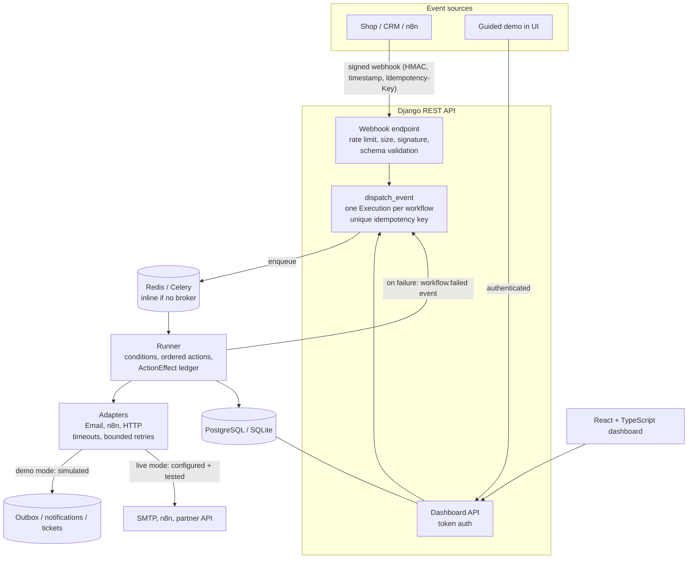
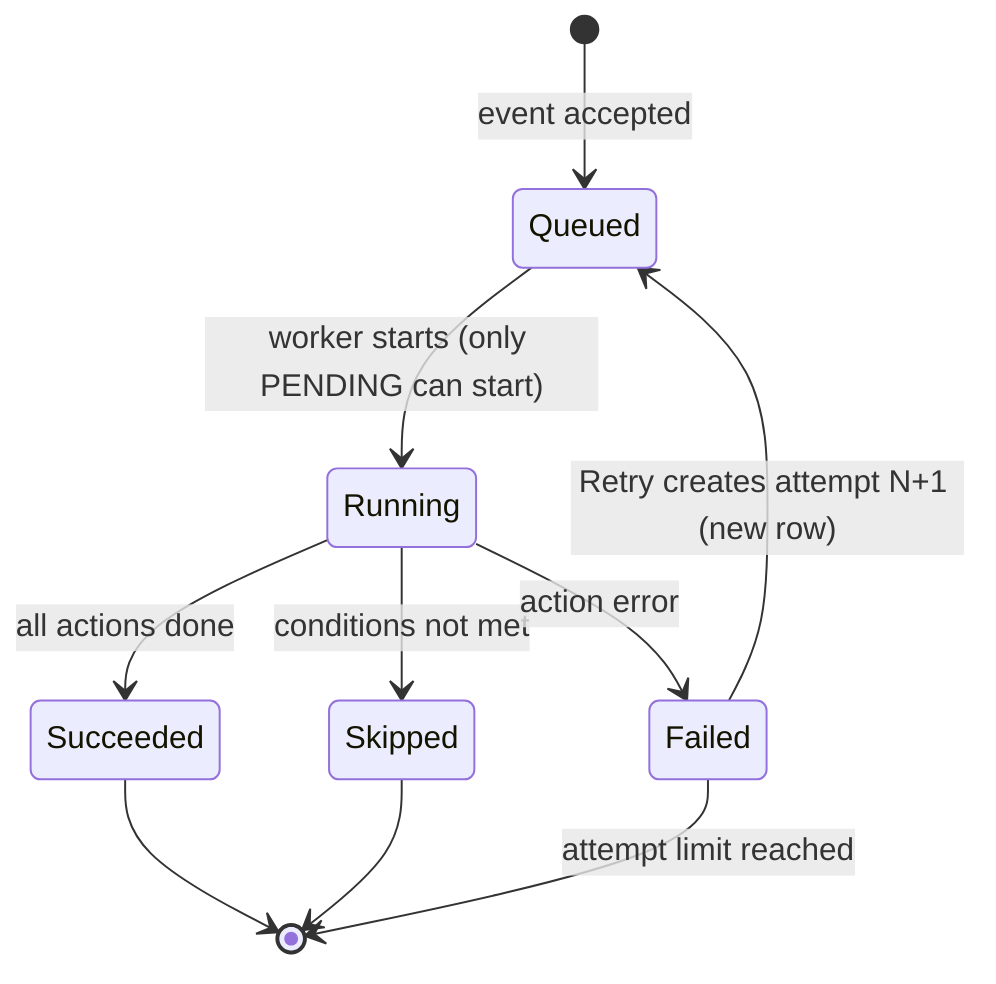
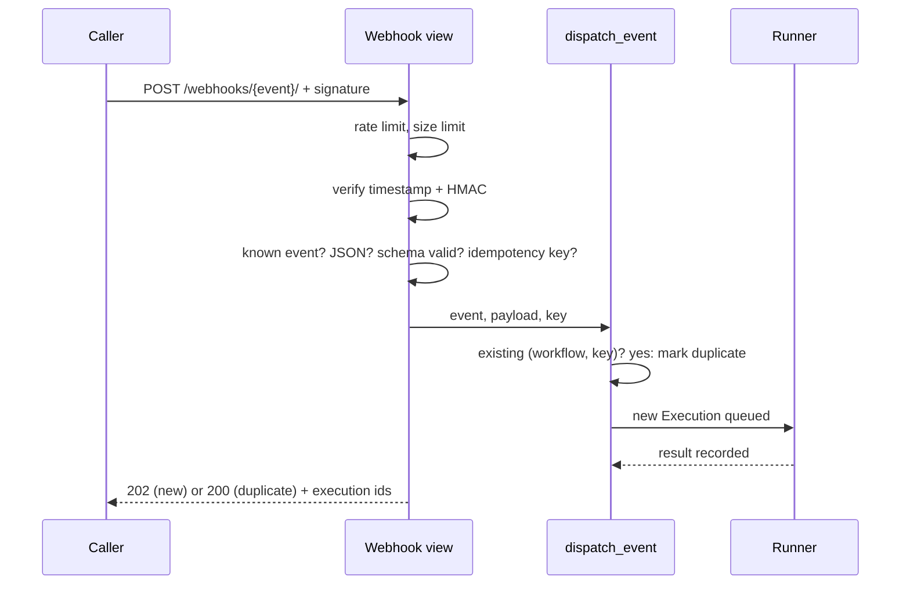

# Architecture

## System overview

## Execution lifecycle

## Webhook request pipeline

## Key design decisions

- **Rules are data, not code.** Conditions and actions are validated JSON; templates are a tiny `{{ payload.x | default:y }}` language with no expression evaluation.
- **Adapters isolate the outside world.** Every external call goes through `BaseAdapter`: demo/live switch, `ensure_ready()`, hard timeouts, bounded retries, redirects not followed, error messages free of secrets.
- **Secrets and URLs are environment-only.** The UI can change harmless settings (timeouts, from-address) but cannot set URLs or secrets, which removes a server-side request forgery path.
- **Failures are data.** A failed run is recorded with a stable error code, a human message and a retryable hint, then emits `workflow.failed`, which the failure-notification workflow turns into an error notification.
- **One data model for local and production.** SQLite for a zero-setup demo, PostgreSQL via `DATABASE_URL`; inline execution without a broker, Celery with Redis when one is configured.
